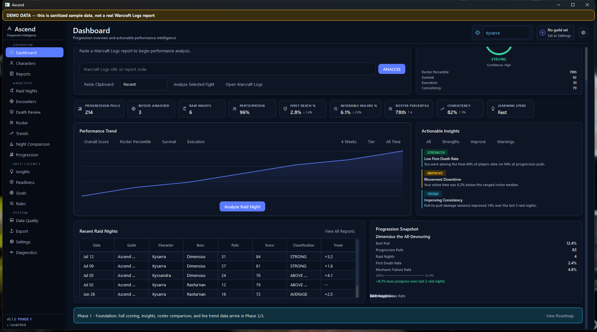

<h1 align="center">Ascend</h1>

<p align="center"><b>Find out how you actually perform across a progression tier, not just what colour your parse is.</b></p>

<p align="center">
  <a href="https://github.com/roryherriman/Ascende/releases/latest"></a>
  <a href="https://github.com/roryherriman/Ascende/actions/workflows/ci.yml"></a>
  
  
  
</p>

<p align="center">
  
  <br><sub>Dashboard with sanitized demo data</sub>
</p>

Ascend is a free Windows desktop app for World of Warcraft raiders. It connects to Warcraft Logs and looks at your raid history across a whole tier, so you can answer the questions a single parse can't:

- Am I improving?
- How often do I die early, and is it the same death every time?
- How consistent am I from pull to pull?
- How do I compare with my own raid team?
- Is missing data skewing any of this?

## Features

| Area | What you get |
|---|---|
| **Progression timeline** | Every pull, every boss, every raid night, plus how your kill rate changed across progression |
| **Death review** | How often you die early, and which deaths you keep repeating |
| **Performance score** | Seven categories (survival, execution, damage, consistency, learning, utility, participation). Each one has a confidence level and shows how it was calculated, input by input. |
| **Roster comparison** | Your attendance and performance compared with your raidmates |
| **Guild discovery** | Syncs recent guild reports from Warcraft Logs, tagged by source (manual or discovered) |
| **Goals & encounter rules** | Set targets and per-encounter rules that feed the insights |
| **Data quality** | Tells you when the data is missing or too thin to score reliably |
| **Export** | JSON export and a weekly summary formatted for Discord |
| **Combat log helper** | Finds your local `WoWCombatLog.txt` and opens the Warcraft Logs uploader |

The scoring model is specified in [`docs/ASCEND_SCORING.md`](docs/ASCEND_SCORING.md).

## Install

1. Download the latest `Ascend-Portable-*.zip` from **[Releases](https://github.com/roryherriman/Ascende/releases/latest)**.
2. Unzip it anywhere and run `Ascend.exe`. There's no installer.
3. The setup wizard asks for:
   - your Warcraft Logs client credentials (create a free client at [warcraftlogs.com/api/clients](https://www.warcraftlogs.com/api/clients/))
   - your characters, current tier (detected automatically, but you can override it) and guild
   - optionally, Battle.net credentials for guild crests

> **Windows SmartScreen** will probably warn that the app is from an unknown publisher, because the build isn't code-signed. Click **More info → Run anyway**.

## Usage

1. Open the **Report Library** and paste a Warcraft Logs report URL or code, or let guild discovery pull in recent reports.
2. Use **Raid Night Summary** for pulls, roster and notes from one night.
3. Use **Death Review**, **Trends** and **Insights** to see what changes across the tier.
4. Check **Data Quality** before you trust a score.

## Your data stays on your machine

- All analysis, history and settings live in SQLite under `%LOCALAPPDATA%\Ascend\`.
- Your Warcraft Logs and Battle.net client secrets and your Discord webhook URL go into **Windows Credential Manager**. If that's unavailable, they fall back to a DPAPI-encrypted file. On systems with neither, they fall back to an obfuscated (not encrypted) file, and Settings shows a warning. They never go into the database, logs or exports.
- Ascend only connects to the Warcraft Logs API when you fetch something. It connects to the Battle.net API only if you add Battle.net credentials for guild crests, and to Discord only when you post a summary to your own webhook. The Discord summary contains totals and boss names, not player names.
- Downloaded report data is kept in that local database until you delete it. Delete the `Ascend` folder to remove everything.
- **File → Back Up Ascend Data** creates a timestamped backup. **Restore** brings it back.

## Run from source

```bat
:: Python 3.11, 64-bit
setup.bat        & :: creates the venv and installs requirements
run_app.bat      & :: launches Ascend
```

```bat
:: Build the portable ZIP yourself
scripts\build_portable.bat
```

Tests use pytest and pytest-qt:

```bat
.venv\Scripts\python -m pytest
```

## Development status

**Completed, v1.0.0.** All 15 planned productisation PRs have landed. The suite has 400+ tests covering the data layer, API layer, sync, scoring and every UI page, and CI runs them on every push. A release workflow builds the portable Windows ZIP from version tags. See [`CHANGELOG.md`](CHANGELOG.md).

## Known limitations

- Windows only (the credential storage and packaging are Windows-specific).
- Scores can only be as good as the logs behind them. Thin or partial reports lower the confidence rather than being hidden.
- Guild rank isn't computed, because Warcraft Logs doesn't expose it.
- The build is unsigned, so SmartScreen will warn on first run.

## Roadmap

See [`docs/ROADMAP.md`](docs/ROADMAP.md) and the issue tracker.

## Licence

*No licence has been chosen yet.* Until one is added, all rights are reserved. Class icon and asset sourcing is documented in [`docs/ASSET_LICENSES.md`](docs/ASSET_LICENSES.md), and bundled third-party software is listed in [`THIRD_PARTY_NOTICES.md`](THIRD_PARTY_NOTICES.md).

---

<sub>Ascend is an independent, unofficial community project. It isn't affiliated with, endorsed by, or sponsored by Blizzard Entertainment, Warcraft Logs or RPGLogs. Report data comes from the Warcraft Logs API. Optional guild crests come from the Blizzard Battle.net API, and Blizzard is the source of that data. World of Warcraft and related trademarks belong to Blizzard Entertainment.</sub>
